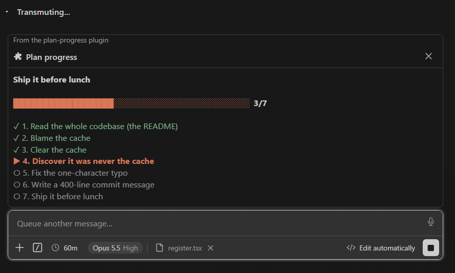
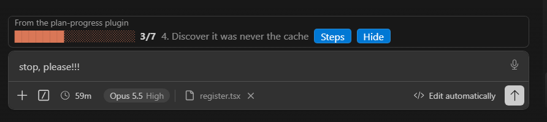
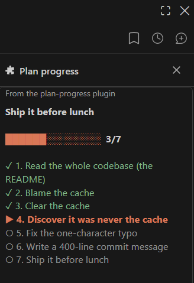

# plan-progress

**Ever wondered what your agent is actually doing? Now you'll always know.**



A [Claude Code](https://claude.com/claude-code) mod that shows where Claude is in a task while it works. When Claude starts a task of three or more steps, it lays out the plan, and you watch it move: a progress bar, the step in hand, and every step ticked off as it is done.

```
████████████░░░░░░░░ 3/5  4. Build the site    [Steps] [Hide]
```

## Install

At the prompt of a Claude Code terminal session:

```
/plugin install plan-progress --marketplace harmyderoman/plan-progress
```

Answer `y` to add the marketplace, then pick a scope (user scope is the first choice).

From a shell:

```
claude plugin install plan-progress --marketplace harmyderoman/plan-progress
```

In the desktop app, where `/plugin` does not run: click **+** next to the prompt box, then **Plugins**, **Add marketplace** with `harmyderoman/plan-progress`, then **Add plugin**.

## What you see

- **Bar above the prompt**: the progress bar, `done/total` and the current step. **Steps** opens the whole list under it (`✓` done, `▶` in progress, `○` ahead), **Less** folds it, **Hide** hides the bar until the next plan.

  

- **Plan pane**: the title, the bar and every step. It docks beside the chat where there is room for it (the terminal's fullscreen layout, the desktop app, a wide VS Code tab) and otherwise opens above the prompt, as in the picture at the top. While the pane is shown, the bar above the prompt stays away, since it would show the same; close the pane and the bar comes back.

  

- **`/progress`**: opens the pane, or the step list above the prompt where there is no pane, and prints a one-line summary.

## Where it works

Anywhere Claude Code draws a mod's interface. The tests run it on all four of these:

| Surface | What you get |
| --- | --- |
| Terminal (`claude`) | The bar above the prompt; the pane beside the chat in the fullscreen layout, above the prompt otherwise. |
| Desktop app | The pane beside the chat, which can also be minimized to a small widget. |
| VS Code | The pane beside the chat in a wide tab, above the prompt in a narrow one, and the bar above the prompt. |
| Claude mobile app | The plan of a Claude Code session the app is attached to. |

It is a Claude Code mod, so it does not appear in the claude.ai chat. Other Claude Code surfaces have not been tested.

## How it works

The mod gives Claude a `progress` tool (`mcp__plan-progress__progress`) and one line in its system prompt asking it to use the tool for tasks of three or more steps.

| Field | Meaning |
| --- | --- |
| `title`, `steps` | Start a plan, or replace the current one. The first step becomes current. |
| `done` | Numbers (1-based) of the steps that are finished. |
| `current` | The step being worked on now. |
| `finished` | Every step is done. |
| `clear` | Remove the plan. |

The mod shows exactly what Claude reported. It reads nothing else from the conversation, writes no files, makes no network requests, and keeps the plan only for the current session. See [AUDIT.md](AUDIT.md) for the full review.

Input is checked before it is used: wrong types are dropped, blank steps are left out, a plan is capped at 50 steps, step texts at 200 characters and the title at 120.

## Cost

The tool's schema and the system-prompt line are sent with every request in a session where the mod is installed, roughly 400 tokens, and each update is one short tool call.

## Develop

Requires Claude Code 2.1.322 or later.

```
claude plugin validate .   # manifest, marketplace file and hooks module
claude plugin test .       # every *.test.ts / *.test.tsx, on the terminal, desktop, VS Code and mobile surfaces
```

To try a working copy in a session: `claude --plugin-dir .` (the folder is watched and reloads on save).

Layout:

| Path | What it is |
| --- | --- |
| `hooks/register.tsx` | The hooks module: the tool, the `/progress` command, the pane and the band above the prompt. |
| `hooks/plan.ts` | The plan logic, free of the engine: input checks, applying a report, the text bar. |
| `hooks/plan.test.ts` | Unit tests for `plan.ts`. |
| `hooks/register.test.tsx` | Tests of the mod as the engine runs it, on every surface. |
| `types/index.d.ts` | The state contract (`Plan`, `Step` and the mod's `$.state` keys). |

Type-checking: when Claude Code loads the mod from this folder (`--plugin-dir`), it writes its API types to `.claude-plugin/types/` (git-ignored), and `tsc -p .` with TypeScript 5.4 or newer then checks the mod and its tests.

## License

[MIT](LICENSE)
